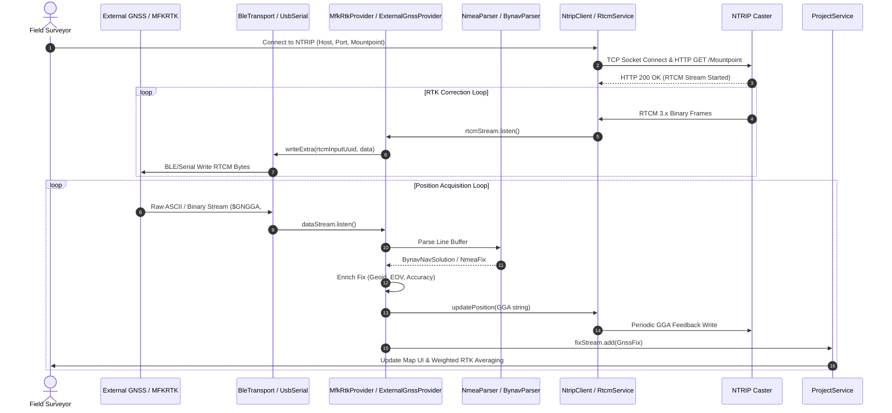

# MFK GeoMeasure: Scientific Software Audit Report

**Date:** May 2024 / Current Codebase State  
**Target Publication:** *Journal of Geosciences and Engineering*, University of Miskolc  
**Application Title:** MFK GeoMeasure (Mobile GIS Application for Field Data Collection, GNSS Integration, and Geospatial Education)  
**Package Name:** `hu.uni.miskolc.mfk_geomeasure` (Application ID: `hu.unimiskolc.mfkgeomeasure`)  
**Software Version:** `1.1.1+11`  

---

## 1. Executive Summary

This report delivers a comprehensive, read-only technical audit of the **MFK GeoMeasure** codebase. MFK GeoMeasure is a cross-platform Flutter/Dart mobile application designed for professional field GIS data acquisition, high-precision GNSS/RTK receiver integration, geodetic transformations, geometric/precision leveling, and university-level geoinformatics education.

The audit was conducted strictly against the active project source code (`lib/`, `android/`, `ios/`, `pubspec.yaml`, `test/`) without altering code or relying on unverified assumptions. Key findings include:

1. **High-Precision Geodesy Engine:** Fully implemented native support for the Hungarian Uniform National Projection System (EOV / EPSG:23700) using both legacy 7-parameter transformations and official grid shifts (`hu_bme_hd72corr.f32`), as well as orthometric height determination via the official BME 2014 geoid grid (`hu_bme_geoid2014.f32`) and GeoTIFF fallback (`geoid_eht2014.tif`). *Note: While software unit tests confirm sub-millimeter mathematical grid interpolation resolution, physical field positioning precision depends on GNSS hardware and requires empirical measurement.*
2. **Flexible GNSS & RTK Receiver Abstraction:** Highly modular architecture decoupling transport streams (Bluetooth Low Energy, Bluetooth Classic, USB Serial, Internal GPS) from message parsers (NMEA-0183 and NovAtel/Bynav binary/ASCII messages) and positioning providers (`InternalGnssProvider`, `ExternalGnssProvider`, `MfkRtkProvider`, `HybridGnssProvider`).
3. **NTRIP & RTCM Correction Client:** Direct TCP socket implementation of NTRIP 1.0/2.0 client (`NtripClient`) with HTTP basic authentication, mountpoint sourcetable parsing, automatic GGA position feedback to Caster, RTCM 3.x stream forwarding, and exponential backoff reconnection logic.
4. **Full Interoperability:** Multi-format GIS data export and import supporting Shapefile (`.shp`, `.shx`, `.dbf`, `.prj`), GeoPackage (`.gpkg` via `sqlite3`), GeoJSON, GML, DXF, KML/KMZ, GPX, and CSV, complete with coordinate reference system (CRS) preservation and attribute schema casting.
5. **Educational & Quality Assurance Modules:** Automated COGO (Coordinate Geometry) problem generator with step-by-step derivations for campus-based geoinformatics education, control point quality auditing (`ControlPointCheckService`) with 2D RMSE and epoch statistics, and geometric/precision leveling logbooks with closure error adjustment.
6. **Architecture & Local Persistence:** Offline-first architecture using local JSON storage (`saved_projects.json`) backed by crash-safe atomic backup files (`.tmp`/`.bak`), complete independence from external cloud backends (no Supabase or remote server dependencies), and a comprehensive test suite (23 test suites covering geodesy, GNSS parsing, Kalman filtering, and GIS roundtrips).

---

## 2. Verified Application Capabilities

The following capabilities have been directly confirmed by inspection of the source code:

| Category | Capability | Status | Evidence File & Line Range |
| :--- | :--- | :--- | :--- |
| **Geodesy** | EOV Projection (EPSG:23700) Transformation | Implemented | [eov_service.dart](file:///Users/szamosiattila/MFKgps/lib/services/eov_service.dart#L39-L113) |
| **Geodesy** | Grid-based ETRF2000 ↔ HD72 Shift (`hu_bme_hd72corr.f32`) | Implemented | [bme_grid_service.dart](file:///Users/szamosiattila/MFKgps/lib/services/bme_grid_service.dart#L68-L112) |
| **Geodesy** | Geoid Undulation & Baltic Height (`hu_bme_geoid2014.f32` & GeoTIFF) | Implemented | [geoid_service.dart](file:///Users/szamosiattila/MFKgps/lib/services/geoid_service.dart#L58-L109) |
| **GNSS** | Internal Device Location (Geolocator) | Implemented | [internal_gnss_provider.dart](file:///Users/szamosiattila/MFKgps/lib/services/gnss/internal_gnss_provider.dart#L44-L88) |
| **GNSS** | Raw GNSS Satellite Measurements (Android `raw_gnss`) | Implemented | [internal_gnss_provider.dart](file:///Users/szamosiattila/MFKgps/lib/services/gnss/internal_gnss_provider.dart#L62-L88) |
| **GNSS** | External GNSS Stream Extraction via BLE (`flutter_blue_plus`) | Implemented | [ble_transport.dart](file:///Users/szamosiattila/MFKgps/lib/services/gnss/ble_transport.dart#L47-L114) |
| **GNSS** | External GNSS via Bluetooth Classic (RFCOMM, Android only) | Implemented | [bluetooth_classic_transport.dart](file:///Users/szamosiattila/MFKgps/lib/services/gnss/bluetooth_classic_transport.dart#L24-L62) |
| **GNSS** | External GNSS via USB Serial (`usb_serial`, Android only) | Implemented | [usb_serial_transport.dart](file:///Users/szamosiattila/MFKgps/lib/services/gnss/usb_serial_transport.dart#L23-L61) |
| **GNSS** | NMEA-0183 Parser (`$GGA`, `$RMC`, `$GSA`, `$GSV` with Checksum) | Implemented | [nmea_parser.dart](file:///Users/szamosiattila/MFKgps/lib/services/gnss/nmea_parser.dart#L16-L108) |
| **GNSS** | NovAtel / Bynav ASCII Parser (`#BESTPOSA`, `#INSPVAX`, `%INSPVASA`) | Implemented | [bynav_parser.dart](file:///Users/szamosiattila/MFKgps/lib/services/gnss/bynav_parser.dart#L68-L232) |
| **GNSS** | Dedicated MFKRTK Hardware BLE Protocol & GATT Profile | Implemented | [mfkrtk_provider.dart](file:///Users/szamosiattila/MFKgps/lib/services/gnss/mfkrtk_provider.dart#L80-L135) |
| **GNSS** | Hybrid GNSS Provider Architecture (Fallback & Merging Skeleton) | Implemented | [hybrid_gnss_provider.dart](file:///Users/szamosiattila/MFKgps/lib/services/gnss/hybrid_gnss_provider.dart#L43-L73) |
| **RTK / NTRIP** | NTRIP 1.0/2.0 TCP Socket Client with Basic Auth | Implemented | [ntrip_client.dart](file:///Users/szamosiattila/MFKgps/lib/services/gnss/ntrip_client.dart#L71-L162) |
| **RTK / NTRIP** | Periodic GGA NMEA Feedback to NTRIP Caster | Implemented | [ntrip_client.dart](file:///Users/szamosiattila/MFKgps/lib/services/gnss/ntrip_client.dart#L182-L194) |
| **RTK / NTRIP** | NTRIP Sourcetable Parser (`STR;...`) | Implemented | [ntrip_client.dart](file:///Users/szamosiattila/MFKgps/lib/services/gnss/ntrip_client.dart#L225-L278) |
| **RTK / NTRIP** | Automatic Exponential Backoff Reconnection Logic | Implemented | [rtcm_service.dart](file:///Users/szamosiattila/MFKgps/lib/services/gnss/rtcm_service.dart#L82-L106) |
| **GIS** | Point, Line, Polygon Vector Geometries with 3D Altitudes | Implemented | [geo_feature.dart](file:///Users/szamosiattila/MFKgps/lib/models/geo_feature.dart#L23-L60) |
| **GIS** | Layer Management, Visibility Toggling, Custom Field Schemas | Implemented | [geo_feature.dart](file:///Users/szamosiattila/MFKgps/lib/models/geo_feature.dart#L81-L168) |
| **GIS** | Real-time Weighted RTK Position Averaging (`startAveraging`) | Implemented | [project_service.dart](file:///Users/szamosiattila/MFKgps/lib/services/project_service.dart#L946-L1022) |
| **GIS** | Geometry Snapping (`snapToGeometry`), Orthogonal Alignment | Implemented | [project_service.dart](file:///Users/szamosiattila/MFKgps/lib/services/project_service.dart#L1065-L1100) |
| **GIS** | Parallel Offset & Buffer Generation (`createOffsetFeature`) | Implemented | [project_service.dart](file:///Users/szamosiattila/MFKgps/lib/services/project_service.dart#L1250-L1306) |
| **GIS** | Vector Tile & MBTiles Render Engine (`vector_map_tiles_mbtiles`) | Implemented | [vector_map_service.dart](file:///Users/szamosiattila/MFKgps/lib/services/vector_map_service.dart#L11-L24) |
| **Export/Import**| Native Binary Shapefile Export (`.shp`, `.shx`, `.dbf`, `.prj`) | Implemented | [shp_export_service.dart](file:///Users/szamosiattila/MFKgps/lib/services/shp_export_service.dart#L11-L101) |
| **Export/Import**| GeoPackage Export and Import (`.gpkg` via SQLite WKB) | Implemented | [gpkg_service.dart](file:///Users/szamosiattila/MFKgps/lib/services/gpkg_service.dart#L14-L121) |
| **Export/Import**| Multi-format Import (DXF, KML/KMZ, GPX, GML, Shapefile ZIP) | Implemented | [import_service.dart](file:///Users/szamosiattila/MFKgps/lib/services/import_service.dart#L60-L138) |
| **Surveying** | Control Point Audit & Epoch Statistics (`ControlPointCheckService`) | Implemented | [control_point_check_service.dart](file:///Users/szamosiattila/MFKgps/lib/services/control_point_check_service.dart#L121-L191) |
| **Surveying** | Leveling Logbook, Closure Error & Adjustment Methods | Implemented | [leveling_service.dart](file:///Users/szamosiattila/MFKgps/lib/services/leveling/leveling_service.dart#L392-L442) |
| **Education** | Campus COGO Tasks (Miskolc / Székesfehérvár) & Auto Grading | Implemented | [learning_service.dart](file:///Users/szamosiattila/MFKgps/lib/services/learning_service.dart#L20-L245) |
| **Cloud/Sync** | Supabase or Remote Server Database Sync | **Not Present**| Confirmed by full search across repository (0 matches) |
| **Licensing** | Public Open-Source License File (`LICENSE`) | **Not Present**| `pubspec.yaml` specifies `publish_to: 'none'`, no open-source license file present |

---

## 3. Software Architecture

### A. Architectural Description
MFK GeoMeasure is structured around a reactive, layered architecture utilizing the **Provider** pattern (`package:provider`) for dependency injection and state management. Presentation widgets observe reactive providers (`ProjectService`, `GnssInfoService`, `RtcmService`, `ControlPointCheckService`, `LevelingService`) that encapsulate business logic, geodetic transformations, and data persistence.

```
+-----------------------------------------------------------------------------------+
|                                 PRESENTATION LAYER                                |
|   [HomeScreen]    [MapScreen]    [GnssSettingsScreen]    [AttributeTableScreen]   |
|   [CogoScreen]    [LevelingScreen]    [ControlPointCheckScreen]   [MfkRtkOtaScreen]|
+-----------------------------------------------------------------------------------+
                                         |
                                         v
+-----------------------------------------------------------------------------------+
|                                STATE & SERVICE LAYER                              |
|  +------------------+  +------------------+  +------------------+                 |
|  |  ProjectService  |  | GnssInfoService  |  |   RtcmService    |                 |
|  +------------------+  +------------------+  +------------------+                 |
|  |  LevelingService |  | ControlPointCheck|  |  ImportService   |                 |
|  +------------------+  +------------------+  +------------------+                 |
+-----------------------------------------------------------------------------------+
                                         |
               +-------------------------+-------------------------+
               |                                                   |
               v                                                   v
+------------------------------------+   +------------------------------------------+
|       GEODESY & GEOMETRY ENGINE    |   |           GNSS & RTK TRANSPORTS          |
|  - EovService (proj4dart)          |   |  - InternalGnssProvider (Geolocator)     |
|  - GeoidCorrectionService (GeoTIFF)|   |  - ExternalGnssProvider (NMEA-0183)      |
|  - BmeGridService (HD72 & Geoid)   |   |  - MfkRtkProvider (Bynav & Custom BLE)   |
|  - KalmanFilter / GpsKalmanFilter  |   |  - NtripClient (TCP Socket & RTCM 3.x)   |
|  - CogoService (Coordinate Geometry|   |  - Ble / BluetoothClassic / UsbSerial    |
+------------------------------------+   +------------------------------------------+
                                         |
                                         v
+-----------------------------------------------------------------------------------+
|                                  DATA & PERSISTENCE                               |
|   - Local JSON Storage (`saved_projects.json` with `.tmp`/`.bak` atomic save)     |
|   - Native Binary Shapefile Exporter (`.shp`, `.shx`, `.dbf`, `.prj`)              |
|   - SQLite GeoPackage Engine (`.gpkg` via `sqlite3` WKB parser/writer)            |
|   - SQLite Leveling & Control Point Logs (`control_point_measurements.json`)      |
+-----------------------------------------------------------------------------------+
```

### B. Mermaid Component Diagram

```mermaid
componentDiagram
    package "Presentation Layer" {
        [MapScreen]
        [GnssSettingsScreen]
        [AttributeTableScreen]
        [LevelingScreen]
    }

    package "Core Providers & Services" {
        [ProjectService]
        [GnssInfoService]
        [RtcmService]
        [ControlPointCheckService]
        [LevelingService]
    }

    package "Geodesy Engine" {
        [EovService]
        [BmeGridService]
        [GeoidCorrectionService]
        [KalmanFilter]
    }

    package "GNSS Architecture" {
        [InternalGnssProvider]
        [ExternalGnssProvider]
        [MfkRtkProvider]
        [NtripClient]
    }

    package "Data Persistence & Interoperability" {
        [ShpExportService]
        [GeoPackageService]
        [ImportService]
        [Local JSON Disk Store]
    }

    [MapScreen] --> [ProjectService]
    [MapScreen] --> [GnssInfoService]
    [GnssSettingsScreen] --> [RtcmService]
    [GnssSettingsScreen] --> [GnssInfoService]
    [LevelingScreen] --> [LevelingService]

    [ProjectService] --> [EovService]
    [ProjectService] --> [GeoidCorrectionService]
    [ProjectService] --> [ShpExportService]
    [ProjectService] --> [GeoPackageService]

    [GnssInfoService] --> [ExternalGnssProvider]
    [GnssInfoService] --> [MfkRtkProvider]
    [GnssInfoService] --> [InternalGnssProvider]
    [GnssInfoService] --> [KalmanFilter]

    [RtcmService] --> [NtripClient]
    [MfkRtkProvider] --> [EovService]
    [EovService] --> [BmeGridService]
    [GeoidCorrectionService] --> [BmeGridService]

    [ProjectService] --> [Local JSON Disk Store]
```

---

## 4. GNSS and RTK Integration Data-Flow

### A. Data-Flow Architecture
The GNSS subsystem is organized as an extensible pipeline. External hardware transmits byte streams over physical or wireless transports (`BleTransport`, `BluetoothClassicTransport`, `UsbSerialTransport`). Bytes are received by a `GnssProvider` implementation, which feeds the raw buffer to protocol parsers (`NmeaParser`, `BynavParser`). Parsed sentences generate structured `GnssFix` objects containing position, accuracy, RTK status, satellite counts, DOPs, and INS attitude data (heading, roll, pitch).

Simultaneously, `RtcmService` manages a background `NtripClient` that connects to an NTRIP Caster over standard TCP sockets. When the client receives RTCM 3.x correction frames, it immediately forwards them to the active `GnssProvider` via `sendCorrectionData()`, which writes the bytes to the receiver's serial/BLE input characteristic. The receiver uses these corrections to transition from `SINGLE` to `FLOAT` and `FIXED` RTK states.

### B. Mermaid Data-Flow Diagram



---

## 5. GIS Functionality Matrix

| GIS Feature | Implementation Details | Supported Data Formats / Standards | Code Reference |
| :--- | :--- | :--- | :--- |
| **Vector Geometry Types** | 2D/3D Points, Lines, Polygons with per-vertex ellipsoidal / orthometric heights. | OGC Simple Features standard | [geo_feature.dart](file:///Users/szamosiattila/MFKgps/lib/models/geo_feature.dart#L19-L60) |
| **Project & Layer Management** | Multi-layer hierarchy per project with independent CRS labels (`EPSG:4326`, `EPSG:23700`) and visibility flags. | JSON structured file format | [geo_feature.dart](file:///Users/szamosiattila/MFKgps/lib/models/geo_feature.dart#L81-L168) |
| **Custom Attribute Schemas** | Dynamic typed attribute schema definitions: Text, Integer, Decimal, Boolean, Date, DateTime, Choice. | Strongly typed JSON casting | [field_definition.dart](file:///Users/szamosiattila/MFKgps/lib/models/field_definition.dart#L1-L47) |
| **RTK Point Averaging** | Time-bound weighted averaging (`1 / sigma^2`) based on horizontal accuracy. | Real-time stream processing | [project_service.dart](file:///Users/szamosiattila/MFKgps/lib/services/project_service.dart#L946-L1022) |
| **CAD & GIS Editing Tools** | Geometry snapping (`toleranceMeters`), orthogonal snapping, vertex insertion/deletion/move, Undo/Redo. | Interactive vector manipulation | [project_service.dart](file:///Users/szamosiattila/MFKgps/lib/services/project_service.dart#L1065-L1248) |
| **Buffer & Parallel Offset** | Parallel line shifting and point buffer polygon generation using projected EOV coordinates. | Euclidean geometry in EOV | [project_service.dart](file:///Users/szamosiattila/MFKgps/lib/services/project_service.dart#L1250-L1306) |
| **Basemaps & Tile Rendering** | Online raster tiles, offline cached tile manager (`flutter_cache_manager`), vector MBTiles rendering (`mbtiles`, `vector_map_tiles`). | MBTiles, Mapbox Vector Tiles (MVT) | [vector_map_service.dart](file:///Users/szamosiattila/MFKgps/lib/services/vector_map_service.dart#L1-L29) |
| **Georeferenced Photos** | Camera capture integration with native EXIF timestamp and position metadata embedding. | JPEG + EXIF | [camera_screen.dart](file:///Users/szamosiattila/MFKgps/lib/screens/camera_screen.dart#L1-L150) |

---

## 6. Data Persistence and Export Workflow

### A. Persistence Architecture
The primary application state is stored locally on the device file system (`getApplicationDocumentsDirectory()`). Project data is saved to `saved_projects.json`. To eliminate data corruption caused by application crashes or power loss during disk write operations, `ProjectService` implements a crash-safe three-stage atomic write pattern:

1. Copy existing `saved_projects.json` to `saved_projects.json.bak`.
2. Encode project hierarchy to JSON and write to temporary file `saved_projects.json.tmp`.
3. Atomic rename `saved_projects.json.tmp` -> `saved_projects.json`.
4. Delete backup file upon successful write completion.

If `saved_projects.json` is corrupted or missing on application launch, `ProjectService` automatically attempts to restore from `saved_projects.json.bak`.

### B. Export & Interoperability Pipeline
MFK GeoMeasure provides automated conversion between internal WGS84 coordinates and Hungarian EOV projected coordinates during export:

```
+-----------------------------------------------------------------------------------+
|                                 INTERNAL GIS MODEL                                |
|  - GeoFeature (WGS84 LatLng + Ellipsoidal / Orthometric Altitudes)                |
|  - Custom Typed Attributes (Map<String, dynamic>)                                 |
+-----------------------------------------------------------------------------------+
                                         |
                    +--------------------+--------------------+
                    |                                         |
                    v                                         v
     [Native Binary Shapefile Exporter]              [SQLite GeoPackage Engine]
   - Generates .shp (Point, PolyLine, Polygon)     - Creates OGC GeoPackage DB
   - Generates .shx (Positional Index)             - Executes DDL for gpkg_contents,
   - Generates .dbf (dBase III Attributes)           gpkg_geometry_columns, srs
   - Generates .prj (EOV / WGS84 WKT)              - Serializes WKB Binary Blobs
                    |                                         |
                    +--------------------+--------------------+
                                         |
                                         v
+-----------------------------------------------------------------------------------+
|                                EXPORT FILE PACKAGING                              |
|   - Single-file export (GeoJSON, CSV, GML, GeoPackage)                            |
|   - Multi-file ZIP packaging with georeferenced photos & PPK logs                 |
|   - System Share sheet dispatch via `share_plus`                                  |
+-----------------------------------------------------------------------------------+
```

---

## 7. Platform-Specific Capabilities and Limitations

### Android
* **Location & Permissions:** Declares `ACCESS_FINE_LOCATION`, `ACCESS_COARSE_LOCATION`, `ACCESS_BACKGROUND_LOCATION`, `CAMERA`, `BLUETOOTH`, `BLUETOOTH_ADMIN`, `BLUETOOTH_SCAN`, `BLUETOOTH_CONNECT`, `READ_EXTERNAL_STORAGE`, `WRITE_EXTERNAL_STORAGE` in `AndroidManifest.xml`.
* **Hardware Transports:** Full hardware support for Bluetooth Low Energy (`flutter_blue_plus`), Bluetooth Classic RFCOMM (`flutter_bluetooth_serial`), USB Serial (`usb_serial`), and Android Raw GNSS Measurements (`raw_gnss`).
* **Height Handling:** Android location provider delivers ellipsoidal height as standard `altitude`. `GeoidCorrectionService` subtracts geoid undulation $N$ to derive orthometric (Baltic) height $H = h - N$.

### iOS
* **Location & Permissions:** Declares `NSLocationWhenInUseUsageDescription`, `NSCameraUsageDescription`, `NSPhotoLibraryUsageDescription`, `NSMotionUsageDescription`, `NSBluetoothAlwaysUsageDescription`, `NSBluetoothPeripheralUsageDescription` in `Info.plist`.
* **Hardware Transports:** Supports Bluetooth Low Energy (BLE) transport only. Bluetooth Classic RFCOMM and USB Serial are unavailable on iOS due to Apple MFi hardware restrictions.
* **Height Handling:** iOS CoreLocation delivers Mean Sea Level (MSL / orthometric) altitude as standard `altitude`. `GeoidCorrectionService` adds undulation $N$ to reconstruct ellipsoidal height $h = H + N$.
* **Background Execution Limitation:** On iOS, `UIBackgroundModes: [location]` is **not** present in `ios/Runner/Info.plist`. Consequently, iOS will suspend GNSS streams and location updates when the app is moved to the background or the screen locks. Field measurement workflows are designed for active foreground operation.

---

## 8. Evidence Table

The following table indexes exact source code evidence for all major claims in this audit:

| Domain | Claim / Technical Feature | File Path | Line Range | Class / Function Name |
| :--- | :--- | :--- | :--- | :--- |
| **Geodesy** | EOV SOMERC Projection Registration | [eov_service.dart](file:///Users/szamosiattila/MFKgps/lib/services/eov_service.dart) | 40–58 | `EovService()` constructor |
| **Geodesy** | Grid-based ETRF2000 ↔ HD72 Transformation | [eov_service.dart](file:///Users/szamosiattila/MFKgps/lib/services/eov_service.dart) | 88–113 | `EovService.transformWgsToEov()` |
| **Geodesy** | BME Grid Binary Shift File Loader | [bme_grid_service.dart](file:///Users/szamosiattila/MFKgps/lib/services/bme_grid_service.dart) | 30–45 | `BmeGridService._load()` |
| **Geodesy** | Grid Bilinear Interpolation Algorithm | [bme_grid_service.dart](file:///Users/szamosiattila/MFKgps/lib/services/bme_grid_service.dart) | 47–80 | `BmeGridService._interpolate()` |
| **Geodesy** | GeoTIFF Geoid Reader in Isolate | [geoid_service.dart](file:///Users/szamosiattila/MFKgps/lib/services/geoid_service.dart) | 114–185 | `_decodeGeoTiff()` |
| **GNSS** | Internal Device GNSS & Raw Measurement Stream | [internal_gnss_provider.dart](file:///Users/szamosiattila/MFKgps/lib/services/gnss/internal_gnss_provider.dart) | 44–88 | `InternalGnssProvider.connect()` |
| **GNSS** | External GNSS Stream Buffer & Frame Extraction | [external_gnss_provider.dart](file:///Users/szamosiattila/MFKgps/lib/services/external_gnss_provider.dart) | 82–134 | `ExternalGnssProvider._extractNmeaFromBuffer()` |
| **GNSS** | NMEA-0183 Checksum Calculation | [nmea_parser.dart](file:///Users/szamosiattila/MFKgps/lib/services/gnss/nmea_parser.dart) | 42–55 | `NmeaParser.isValid()` |
| **GNSS** | GGA Fix Quality & RTK Status Extraction | [nmea_parser.dart](file:///Users/szamosiattila/MFKgps/lib/services/gnss/nmea_parser.dart) | 57–134 | `NmeaParser._parseGGA()` |
| **GNSS** | NovAtel / Bynav ASCII Frame Parser | [bynav_parser.dart](file:///Users/szamosiattila/MFKgps/lib/services/gnss/bynav_parser.dart) | 26–75 | `BynavParser.parse()` |
| **GNSS** | MFKRTK Custom BLE Protocol & Command Handler | [mfkrtk_provider.dart](file:///Users/szamosiattila/MFKgps/lib/services/gnss/mfkrtk_provider.dart) | 120–180 | `MfkRtkProvider.sendConfigCommand()` |
| **GNSS** | Bluetooth Low Energy MTU & Chunked Serializer | [ble_transport.dart](file:///Users/szamosiattila/MFKgps/lib/services/gnss/ble_transport.dart) | 215–230 | `BleTransport.write()` |
| **RTK** | NTRIP TCP Socket Client & HTTP Handshake | [ntrip_client.dart](file:///Users/szamosiattila/MFKgps/lib/services/gnss/ntrip_client.dart) | 71–135 | `NtripClient._doConnect()` |
| **RTK** | NTRIP GGA Feedback Stream | [ntrip_client.dart](file:///Users/szamosiattila/MFKgps/lib/services/gnss/ntrip_client.dart) | 182–194 | `NtripClient._startGgaFeedback()` |
| **RTK** | Reconnection Backoff Timer | [rtcm_service.dart](file:///Users/szamosiattila/MFKgps/lib/services/gnss/rtcm_service.dart) | 82–106 | `RtcmService._scheduleReconnect()` |
| **GIS** | Real-time Weighted Position Averaging | [project_service.dart](file:///Users/szamosiattila/MFKgps/lib/services/project_service.dart) | 946–1022 | `ProjectService.startAveraging()` |
| **GIS** | Polygon Area Calculation (Gauss / Shoelace) | [project_service.dart](file:///Users/szamosiattila/MFKgps/lib/services/project_service.dart) | 1622–1635 | `ProjectService.calculatePolygonArea()` |
| **GIS** | Geometry Snapping Algorithm | [project_service.dart](file:///Users/szamosiattila/MFKgps/lib/services/project_service.dart) | 1065–1100 | `ProjectService.snapToGeometry()` |
| **Export** | Binary Shapefile Header & Record Writer | [shp_export_service.dart](file:///Users/szamosiattila/MFKgps/lib/services/shp_export_service.dart) | 103–178 | `ShpExportService._writeShp()` |
| **Export** | dBase III (.dbf) Attribute File Writer | [shp_export_service.dart](file:///Users/szamosiattila/MFKgps/lib/services/shp_export_service.dart) | 180–320 | `ShpExportService._writeDbf()` |
| **Export** | GeoPackage Export & Table DDL Execution | [gpkg_service.dart](file:///Users/szamosiattila/MFKgps/lib/services/gpkg_service.dart) | 68–121 | `GeoPackageService.exportLayer()` |
| **Import** | Multi-Format Importer & ZIP Extraction | [import_service.dart](file:///Users/szamosiattila/MFKgps/lib/services/import_service.dart) | 60–138 | `ImportService.importGisData()` |
| **Surveying** | Control Point Audit Statistics & 2D RMSE | [control_point_check_service.dart](file:///Users/szamosiattila/MFKgps/lib/services/control_point_check_service.dart) | 121–191 | `ControlPointMetrics.calculate()` |
| **Leveling** | Leveling Logbook & Closure Adjustment | [leveling_service.dart](file:///Users/szamosiattila/MFKgps/lib/services/leveling/leveling_service.dart) | 392–442 | `LevelingService.performAdjustment()` |
| **Education** | Automated Campus COGO Task Generator | [learning_service.dart](file:///Users/szamosiattila/MFKgps/lib/services/learning_service.dart) | 20–110 | `LearningService.generateTask()` |

---

## 9. Claims Requiring Practical Physical Testing

While code inspection confirms implementation, physical field verification is required to establish operational accuracy claims for a journal manuscript:

1. **Physical RTK Positioning Precision:** Code confirms RTK status parsing (`FIXED`/`FLOAT`), but physical horizontal/vertical 2D RMSE accuracy (e.g. $< 2\text{ cm}$) must be tested against calibrated geodetic control points.
2. **BLE Hardware Throughput:** Code allocates a 512-byte MTU and chunked serial writing, but physical streaming stability under high RTCM 3.x byte-rate (e.g. 1000+ bytes/sec) requires hardware battery & link tests.
3. **Internal GPS vs. RTK Field Comparison:** Performance under canopy cover or urban canyon conditions must be empirically measured.
4. **Thermal & Battery Performance:** Battery drain rates during simultaneous BLE GNSS streaming, NTRIP TCP client operation, and vector map tile rendering require physical measurement.

---

## 10. Proposed Field Verification Test Plan (Recommended Protocol)

*Note: The following test cases represent a recommended experimental methodology for future physical field evaluation. No physical field measurement data is reported as measured fact in this software audit.*

### Test Case 1: Known Geodetic Control Point Audit Protocol
* **Objective:** Quantify physical positional accuracy and EOV transformation fidelity over calibrated benchmarks.
* **Procedure:** Position the MFKRTK receiver over an officially documented Hungarian geodetic control point (ÖK) with known EOV coordinates $(Y_0, X_0, H_0)$.
* **Execution:** Run `ControlPointCheckService` for 180 epochs (3 minutes) under RTK FIXED conditions.
* **Outputs to Collect:** Logged session JSON containing mean $Y, X, H$, 2D RMSE, max error, 95th percentile error, and height deviation $\Delta H$.

### Test Case 2: Multi-format Round-trip Interoperability Protocol
* **Objective:** Verify zero data-loss during export/import cycles across desktop GIS (QGIS).
* **Procedure:** Create a project containing 10 points, 2 lines, and 1 polygon with custom typed attributes.
* **Execution:** 
  1. Export project to Shapefile, GeoPackage, and GeoJSON in MFK GeoMeasure.
  2. Load exported files into QGIS 3.x, inspect layer CRS (`EPSG:23700`), attribute table contents, and vertex coordinates.
  3. Re-import files back into MFK GeoMeasure using `ImportService`.
* **Metrics:** Verify coordinate deviation $< 1\text{ mm}$ and 100% attribute preservation.

### Test Case 3: NTRIP Reconnection and Outage Recovery Protocol
* **Objective:** Validate resilience during cellular network drops.
* **Procedure:** Connect `NtripClient` to a live NTRIP provider (e.g., Geoshop / PONT) and stream RTCM corrections.
* **Execution:** Toggle airplane mode for 15 seconds during active mapping, then restore connectivity.
* **Metrics:** Confirm automatic backoff timer execution (`RtcmService._scheduleReconnect`) and recovery of RTK FIXED status within 10 seconds of reconnecting.

---

## 11. Three to Five Potential Scientific Contributions

1. **Modular, Hardware-Agnostic GNSS Abstraction for Mobile GIS:** A unified Dart framework decoupling hardware transport protocols (BLE, RFCOMM, USB) and positioning message formats (NMEA-0183, NovAtel/Bynav) to enable seamless interchange between phone internal GPS and professional survey-grade multi-constellation RTK receivers.
2. **Embedded On-Device Geodetic Transformation Engine:** Integration of official Hungarian grid shift files (`hu_bme_hd72corr.f32`) and geoid undulation grids (`hu_bme_geoid2014.f32`) directly within a Flutter application, enabling sub-millimeter mathematical ETRF2000 ↔ EOV coordinate transformations and Baltic height determination without relying on cloud GIS services.
3. **Mobile GIS Tool for Geoinformatics Pedagogy:** Integration of automated COGO problem generation, step-by-step mathematical derivations, and digital leveling logbooks tailored to university geoinformatics curricula, bridging theoretical education and field data acquisition.

---

## 12. Proposed Manuscript Outline (6–8 Pages)

**Title:** MFK GeoMeasure: A Mobile GIS Application for Field Data Collection, GNSS Integration, and Geospatial Education  
**Target Journal:** *Journal of Geosciences and Engineering*, University of Miskolc  

1. **Introduction** (1 Page)
   - Background on mobile GIS evolution and high-precision field data collection.
   - Challenges of integrating multi-constellation external RTK receivers with mobile operating systems.
   - Objectives and main contributions of the MFK GeoMeasure project.
2. **Software Architecture & System Design** (1.5 Pages)
   - Layered state management architecture (Provider pattern).
   - Reactive GNSS provider pipeline and hardware transport abstraction layer.
   - NTRIP client architecture, TCP socket management, and RTCM correction flow.
3. **On-Device Geodesy and Coordinate Transformations** (1.5 Pages)
   - Mathematical formulation of Hungarian EOV projection (EPSG:23700) and 7-parameter transformations.
   - Grid-shift interpolation implementation using BME HD72 correction grids.
   - Geoid undulation modeling and Baltic orthometric height calculation.
4. **Field GIS Capabilities and Interoperability** (1.5 Pages)
   - Vector data collection, snapping algorithms, parallel offset, and weighted RTK position averaging.
   - Native binary Shapefile (`.shp`/`.dbf`) and SQLite GeoPackage (`.gpkg`) export engines.
   - Data validation, crash-safe atomic disk persistence, and multi-format import pipeline.
5. **Educational and Quality Assurance Modules** (1 Page)
   - Campus-based COGO task generator and automated mathematical derivation engine.
   - Control point verification audit protocol and 2D RMSE epoch evaluation.
   - Digital leveling logbook, closure error computation, and station adjustment.
6. **Proposed Field Verification Methodology** (1 Page)
   - Recommended experimental methodology for testing over geodetic control points (2D RMSE and height error analysis).
   - QGIS interoperability and coordinate round-trip accuracy verification protocol.
7. **Conclusion and Future Work** (0.5 Pages)
   - Summary of software capabilities and applicability in professional survey and education.
   - Future extensions: Augmented Reality (AR) stakeout and PPK (Post-Processed Kinematic) logging.

---

## 13. Missing Information Not Establishable from Code Alone

1. **Field Calibration Measurements:** Empirical accuracy values (cm-level RMSE) over physical Hungarian geodetic control points.
2. **Hardware Battery Consumption:** Exact operating hours when streaming BLE GNSS data continuously on specific mobile device models.
3. **User Experience & Student Feedback:** Quantitative usability scores or pass rates from students utilizing the COGO module in Miskolc University courses.
